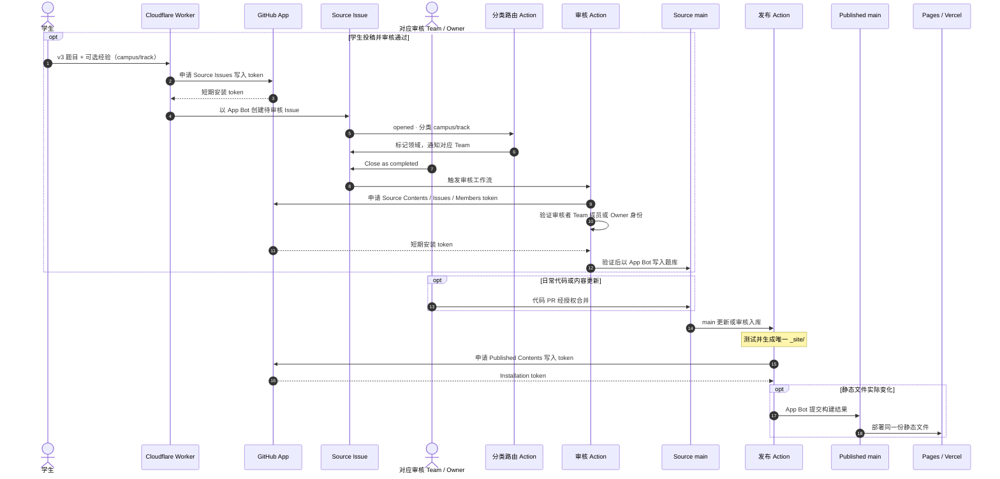

# HKUST-ELPA-Site-Source

香港科技大学及香港科技大学（广州）学生维护的非官方 ELPA 口语备考网站。本仓库是唯一的源码与构建入口；生成的静态文件发布到 [HKUST-ELPA.github.io](https://github.com/HKUST-ELPA/HKUST-ELPA.github.io)，供 [GitHub Pages](https://hkust-elpa.github.io/) 和 [Vercel](https://hkust-elpa.vercel.app/) 使用。

[](https://github.com/HKUST-ELPA/HKUST-ELPA-Site-Source/actions/workflows/site-checks.yml) [](https://github.com/HKUST-ELPA/HKUST-ELPA-Site-Source/actions/workflows/deploy-pages.yml)


## 网站功能

- **考试指南**：查阅常规 ELPA、Fast Track 流程与学生备考经验。
- **题库练习**：按校区、考试类型、场次和学习状态筛选，使用 Pagefind 搜索题目及小问，随机抽题并计时。
- **学习记录**：在本地浏览器保存掌握状态与笔记，支持备份和恢复。更换设备或网站地址前请先备份。
- **社区投稿**：通过 Cloudflare Worker 提交考题及可选备考经验，由对应校区和考试类型的审核 Team 审核后收录。

网站不代表学校官方立场；考试安排与要求以学校当期通知为准。投稿请勿包含姓名、学号或联系方式。

## 项目结构

```text
HKUST-ELPA-Site-Source/
├── .github/workflows/  # PR 验证、审核入库与跨仓库发布
├── assets/             # 样式、脚本与媒体
├── data/               # 投稿配置与学习记录模板
├── question-bank/      # 题库、场次、经验与出处
├── scripts/            # 静态构建、校验与审核入库
├── tests/              # 单元与浏览器回归测试
├── worker/             # Cloudflare 投稿接口
├── index.html          # 首页、指南和资料来源的内容入口
├── practice.html       # 题库练习
├── submit.html         # 社区投稿
├── preview.py          # 本地预览与静态构建入口
├── PUBLISHED_README.md # Published README 的唯一来源
└── requirements-dev.txt
```

## 技术栈

- **HTML / CSS / JavaScript**：静态页面、题库交互与本地学习记录
- **Python**：生成六个页面及浏览器题库资源
- **Cloudflare Worker + Turnstile**：校验投稿并创建 Source Issue
- **GitHub Issues + Actions**：审核入库、测试和跨仓库发布
- **GitHub App**：同一 App 分别申请 Source 投稿、审核入库和 Published 发布所需的短期安装 token

## 本地开发

需要 Python 3.10+。在 Source 根目录运行以下命令，启动本地预览：

```sh
python preview.py
```

打开 <http://127.0.0.1:8765/>；修改源码后刷新页面即可查看结果，结束时按 Ctrl+C。Windows 可使用 `py -3` 替代 `python`。只构建、运行测试或检查浏览器时，按 [PREVIEW.md](PREVIEW.md) 中对应步骤操作；运行 JavaScript 测试需要 Node.js 22+。

## 构建与发布

**Source**（本仓库）维护页面、四领域题库（GZ-R / GZ-F / HK-R / HK-F）、Team 投稿审核和唯一的生产构建。**Published**（`HKUST-ELPA/HKUST-ELPA.github.io`）只保存构建结果；GitHub Pages 与 Vercel 直接部署其 `main`，不再构建网站。Published 的 `README.md` 由 [PUBLISHED_README.md](PUBLISHED_README.md) 生成。



发布工作流也支持手动触发。静态文件没有变化时不会产生 Published 提交；`build-info.json` 记录 Source 提交与构建运行，供追溯和回滚。学习记录只保存在用户浏览器，不进入仓库。

## 文档与参与

- [AGENTS.md](AGENTS.md)：工程原则与验证边界
- [PREVIEW.md](PREVIEW.md)：本地开发、凭据与部署操作
- [question-bank/README.md](question-bank/README.md)：题库结构与来源
- [question-bank/MODERATION.md](question-bank/MODERATION.md)：投稿审核与入库
- [worker/README.md](worker/README.md)：Worker 部署与安全配置
- [PUBLISHED_README.md](PUBLISHED_README.md)：Published README 的唯一来源

欢迎通过 [Issues](https://github.com/HKUST-ELPA/HKUST-ELPA-Site-Source/issues) 反馈资料问题，或通过 [Pull Requests](https://github.com/HKUST-ELPA/HKUST-ELPA-Site-Source/pulls) 参与共建。

**Built with Passion. Shared with Everyone.** Initiated by [FuTseYi](https://github.com/FuTseYi).
